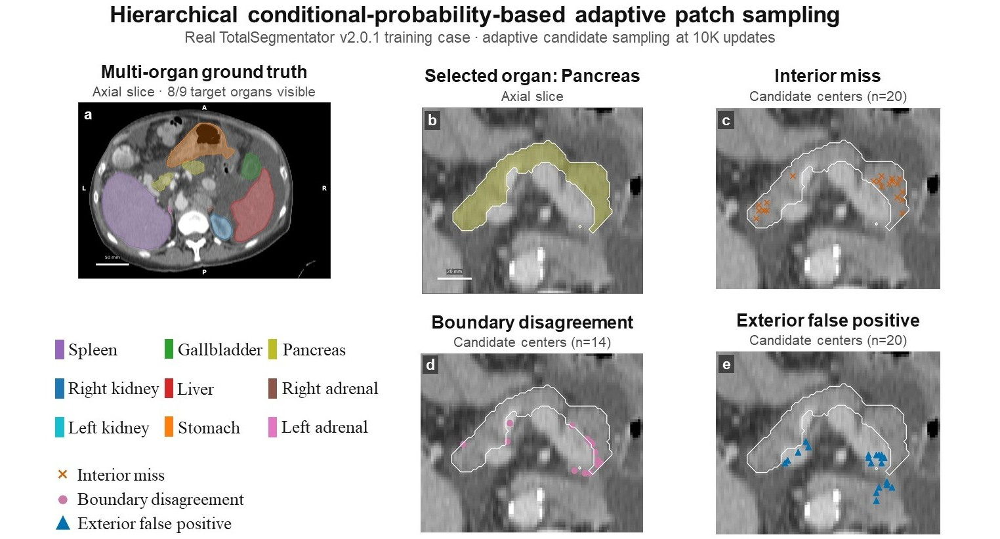
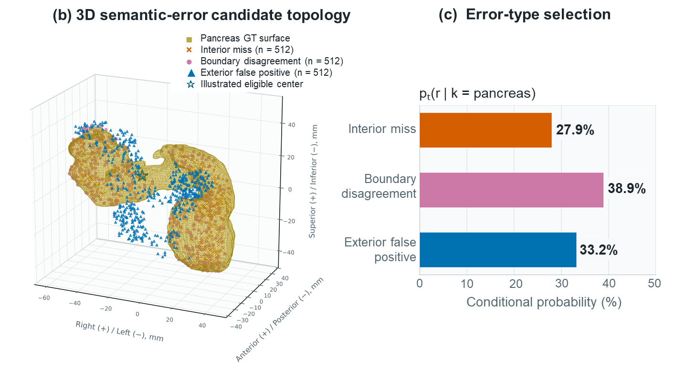
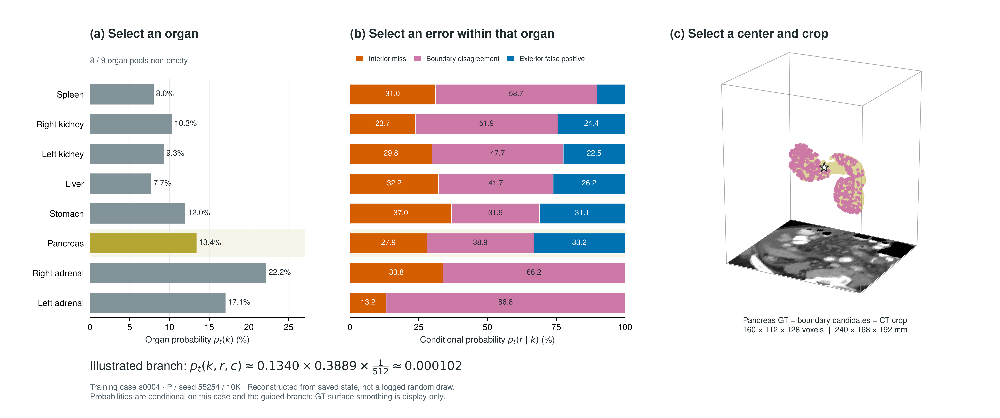
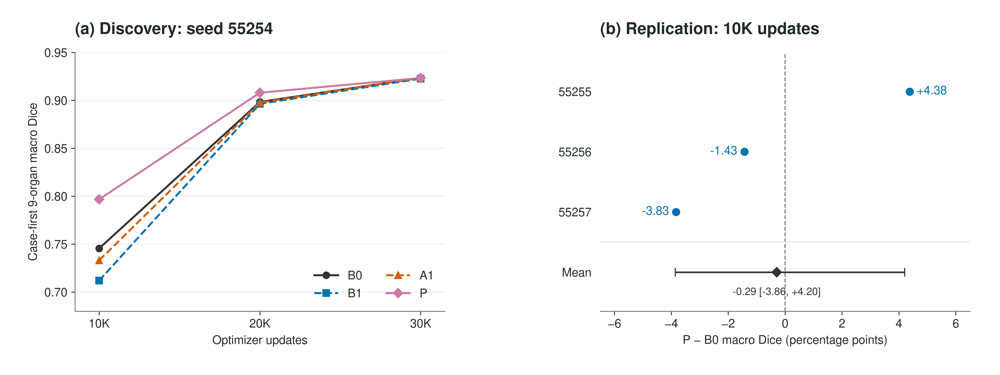

# Hierarchical Conditional-Probability-Based Adaptive Patch Sampling

*Organ-Wise Learning States and Error Types for 3D Abdominal CT Multi-Organ Segmentation*

## Overview

Adaptive patch sampling for **3D abdominal CT multi-organ segmentation**, guided by organ-wise learning states and prediction error types. The nnU-Net architecture remains unchanged.

**Research question:** Can organ-aware and error-type-aware patch allocation improve segmentation learning at the same optimizer-update budget?

**Observed result (single training run):** On 28 validation cases, the proposed policy (**P**) exceeded the nnU-Net baseline (**B0**) by **+5.1228 percentage points at 10K updates**, but the difference narrowed to **-0.0139 pp at 30K**. This is a descriptive observation, not evidence of consistent superiority.

## Motivation & Research Objective

3D full-resolution CT segmentation is commonly trained on smaller 3D patches because processing an entire volume at once is resource-intensive. nnU-Net's foreground oversampling increases the chance of including annotated structures, but it does not explicitly adapt patch allocation to **which organ is currently difficult** or **which prediction-error type remains for that organ**.

This study asks whether adapting those sampling decisions can change segmentation performance **under a fixed number of optimizer updates**, while leaving the network architecture, preprocessing, loss, and augmentation unchanged. The objective is to evaluate a **sampling policy**, not propose a new segmentation network.

## Main Contributions

1. **Organ-aware allocation:** estimate an organ-specific learning state from observed Dice deficits and combine difficulty-weighted allocation with a uniform component.
2. **Error-type-aware conditional allocation:** distinguish interior misses, boundary disagreements, and exterior false positives when selecting patch centers.
3. **Controlled policy comparison:** compare baseline foreground oversampling (**B0**), static online candidates (**B1**), organ-adaptive selection (**A1**), and the full hierarchical policy (**P**) using matched training settings.

The contribution is the **training-time allocation design and its evaluation**; the conditional-probability chain rule itself is not claimed as a novel mathematical result.

## Proposed Method



The guided sampling branch follows a **hierarchical conditional-probability structure**: select an organ $k$, an error type $r$ conditioned on that organ, and a patch center $c$ from the corresponding candidate pool.

$$
p_t(k,r,c) = p_t(k)\,p_t(r \mid k)\,p_t(c \mid k,r)
$$

Organ selection uses a smoothed Dice deficit; error-type selection combines current
candidate counts with historical error shares. A 3D patch is cropped around the
selected center. These probabilities describe the guided branch, not every patch.

### Sampling equations

For the current training case, $K_t$ contains organs with candidates,
$R_t(k)$ contains their non-empty error types, and $C_t(k,r)$ is a candidate pool.
States are updated from training-only observer patches, not validation labels.

**1. Organ learning state and selection**

Let $D_k^{(t)}$ be the observed hard Dice for organ $k$. Its deficit is smoothed
with an exponential moving average (EMA):

$$e_t(k)=1-D_k^{(t)},\qquad d_t(k)=\beta d_{t-1}(k)+(1-\beta)e_t(k).$$

$$p_t(k)=\frac{1-\lambda_k}{|K_t|}+\lambda_k\frac{d_t(k)}{\sum_{j\in K_t}d_t(j)}.$$

Here $\beta=0.9$ and $\lambda_k=0.5$. The uniform component keeps each eligible
organ selectable: $p_t(k)\geq(1-\lambda_k)/|K_t|$.

**2. Error type conditioned on the selected organ**

$$b_t(r\mid k)=\frac{|C_t(k,r)|}{\sum_{r'\in R_t(k)}|C_t(k,r')|}.$$

$$p_t(r\mid k)=(1-\lambda_r)b_t(r\mid k)+\lambda_r a_t(r\mid k).$$

$a_t(r\mid k)$ is the EMA of observed error-type shares, renormalized over
available types; $\lambda_r=0.5$. Those shares use raw observer error counts,
whereas $b_t$ uses bounded candidate-pool counts.

**3. Center conditioned on organ and error type**

$$p_t(c\mid k,r)=\frac{1}{|C_t(k,r)|},\qquad c\in C_t(k,r).$$

Each EMA starts from its first valid observation. Both-empty Dice observations
are skipped. Zero total organ difficulty falls back to uniform selection;
unavailable error-state mass falls back to the candidate-count distribution.
The hierarchy and mixtures follow the manuscript; the probability lower bound
above is a direct consequence, not an additional method.

| Candidate type | What the model is getting wrong | What the patch targets |
| :--- | :--- | :--- |
| Interior miss | Missed voxels inside the reference organ, away from its boundary | Organ recognition |
| Boundary disagreement | Prediction–label disagreement near the organ surface | Boundary delineation |
| Exterior false positive | That organ predicted outside the reference boundary band | Confusion with surrounding tissue |



*Training case `s0004` · pancreas · P / seed 55254 / 10K updates.*
Markers show bounded candidate reservoirs, not every error. The highlighted center
is illustrative, not a recorded training draw; surface smoothing is for display.

### From conditional probabilities to a 3D patch



The saved state links eight eligible organs to their error-type distributions and
an illustrative pancreas-centered crop; the gallbladder pool is empty in this snapshot.
These are sampling probabilities, not prediction confidence.

## Experimental setup

| Setting | Configuration |
| :--- | :--- |
| Dataset | TotalSegmentator v2.0.1 |
| Cohort | 602 eligible cases with all nine target masks non-empty |
| Official split retained | 525 train / 28 validation / 49 test |
| Framework | nnU-Net v2.8.1 · `3d_fullres` |
| Spacing / patch / batch | 1.5 mm isotropic / `160 × 112 × 128` / 2 |
| Training budget | 30,000 optimizer updates per run |
| Main metric | Organ macro Dice within each case, then the mean across cases |

Targets: spleen, right/left kidneys, gallbladder, liver, stomach, pancreas,
and right/left adrenal glands. Non-empty labels do **not** establish complete
anatomical coverage. Cohort filtering narrows the population to which results apply.

The comparisons keep the network, preprocessing, loss, augmentation, and update
budget matched while varying sampling. B1/A1/P share the online candidate mechanism.

| Policy | Online error candidates | Organ adaptation | Error-type adaptation |
| :--- | :---: | :---: | :---: |
| **B0** · nnU-Net foreground oversampling | — | — | — |
| **B1** · static candidate allocation | ✓ | — | — |
| **A1** · organ-adaptive allocation | ✓ | ✓ | — |
| **P** · hierarchical conditional sampling | ✓ | ✓ | ✓ |

For policy $m$ at update $u$, case-first macro Dice and the P–B0 difference are

$$
S_m(u)=\frac{1}{N}\sum_{i=1}^{N}
\left(\frac{1}{9}\sum_{k=1}^{9}\mathrm{Dice}_{i,k}^{(m,u)}\right),
$$

$$
\Delta_{\mathrm{pp}}(u)=100\left[S_P(u)-S_{B0}(u)\right].
$$

Each case and organ has equal weight. These are full-volume evaluation scores,
distinct from the observer-patch Dice used for sampling.

## Results & Discussion

**Single-run discovery comparison:** training seed **55254**, **28 validation cases**. Values are the case-first 9-organ macro Dice.



*Figure: Left—B0/B1/A1/P learning curves from training seed 55254; right—10K P − B0 across independent training seeds, including a bootstrap uncertainty interval. The table below summarizes the left-panel discovery run only.*

| Policy | 10K Dice | 20K Dice | 30K Dice |
| :--- | ---: | ---: | ---: |
| B0 | 0.745542 | 0.898442 | 0.923552 |
| B1 | 0.711985 | 0.896431 | 0.922776 |
| A1 | 0.733086 | 0.897731 | 0.923548 |
| P | **0.796770** | **0.908046** | 0.923413 |
| **P − B0** | **+5.1228 pp** | **+0.9603 pp** | -0.0139 pp |

Source: [discovery results CSV](paper/results/table01_discovery.csv). A positive P − B0 difference favors P; results are measured in percentage points (pp).

**Interpretation.** In this run, P had the highest 10K Dice, whereas B1 and A1 were below B0 at the same point. Thus, adding sampling components did **not** produce a monotonic improvement across the intermediate policies. The P − B0 advantage shrank at 20K and was essentially absent at 30K. These observations generate a hypothesis about early-stage allocation, but do not establish its mechanism or a generally superior policy.

**Boundary-sensitive metrics at 30K.** In the same validation run, NSD@3 mm was **0.965922 (B0)** versus **0.964456 (P)**; mean reported HD95 was **4.667 mm (B0)** versus **6.121 mm (P)**. These summaries do not indicate a boundary-metric advantage for P. HD95 omits undefined empty-prediction measurements, so subtracting the displayed means is not a valid paired HD95 effect estimate. Source: [surface metrics CSV](paper/results/table04_surface_metrics.csv).

## Limitations

- **Evidence scope:** the displayed learning curves cover one training run and one 28-case validation split. They describe that run; they cannot establish a statistically reliable advantage across training conditions.
- **Cohort selection:** only cases with all nine target masks non-empty were included. This restricts the evaluated population and does not guarantee complete anatomical coverage.
- **Compute interpretation:** matching 30,000 optimizer updates does not demonstrate equal wall-clock time or GPU cost. The overhead of maintaining online candidate states is not quantified here.
- **Method scope:** the probability equations govern the **guided sampling branch**, not every training patch. This README does not fully specify branch activation frequency or all candidate-generation thresholds.
- **Available materials:** this repository publishes method descriptions, figures, and aggregate result files; it is not a release of the underlying nnU-Net trainer implementation.

## Conference & Resources

**Hierarchical Conditional-Probability-Based Adaptive Patch Sampling with Organ-Wise Learning States and Error Types for 3D Abdominal CT Multi-Organ Segmentation**

*3차원 복부 CT 다장기 분할을 위한 계층적 조건부 확률 기반의 장기별 학습 상태 및 오류 유형 적응형 패치 샘플링*

| Item | Details |
| --- | --- |
| Conference | 2026 한국정보기술학회 추계종합학술대회 · 대학생논문경진대회 |
| Research Area | Deep Learning · Medical AI · Medical Image Segmentation |
| Author | 박용민 (**Sole Author**) |
| Email | add28482848@kyonggi.ac.kr |
| Affiliation | 경기대학교 AI컴퓨터공학부 |


### Repository scope

```text
hierarchical-patch-sampling-3d/
├── README.md                Method, experimental setup, results
├── paper/
│   ├── figures/             Method illustrations and result figures
│   └── results/             Aggregate CSVs and sampling probabilities
└── studies/prerequisites/   20 educational notebooks
```

The work uses [TotalSegmentator v2.0.1](https://doi.org/10.5281/zenodo.10047292)
(CC BY 4.0) and [nnU-Net](https://github.com/MIC-DKFZ/nnUNet).
Medical-image figures derive from that dataset.
